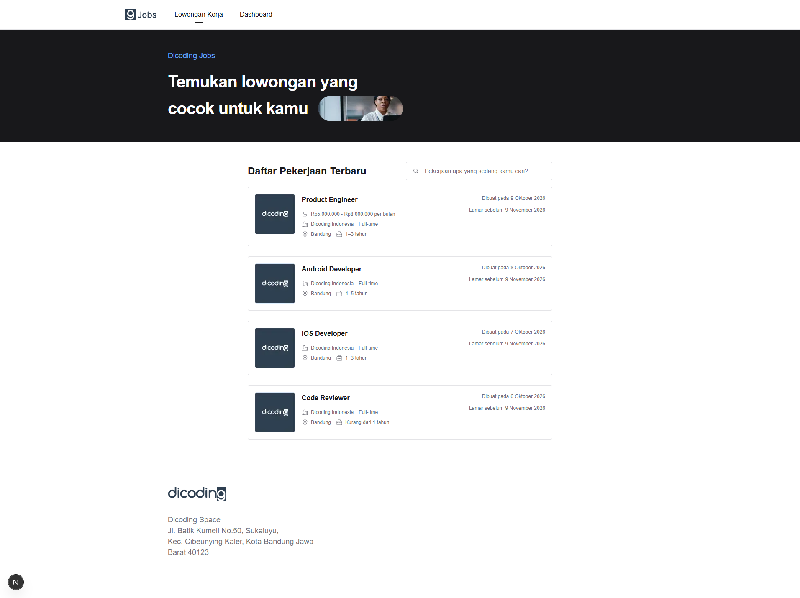
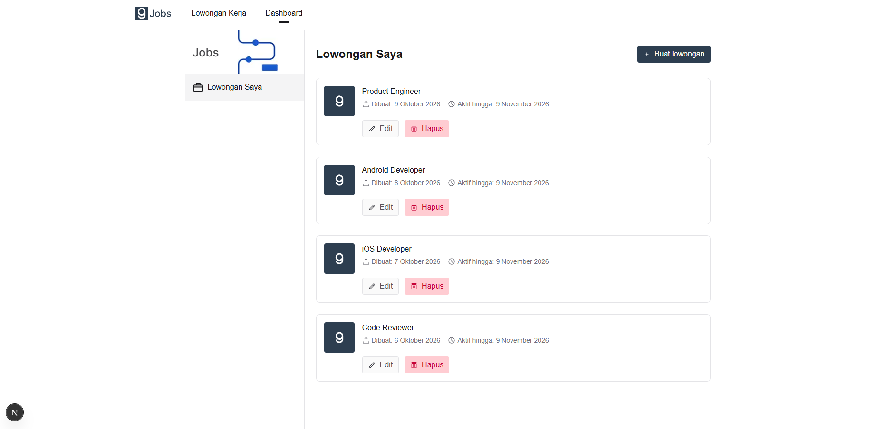
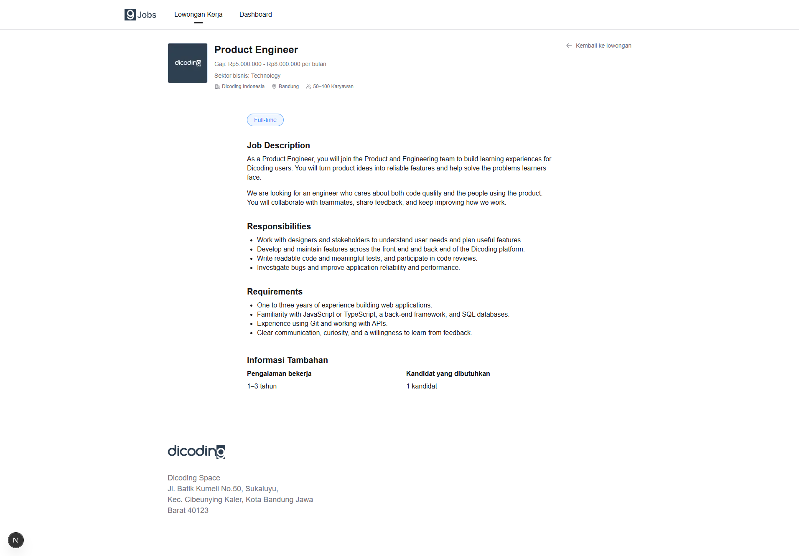
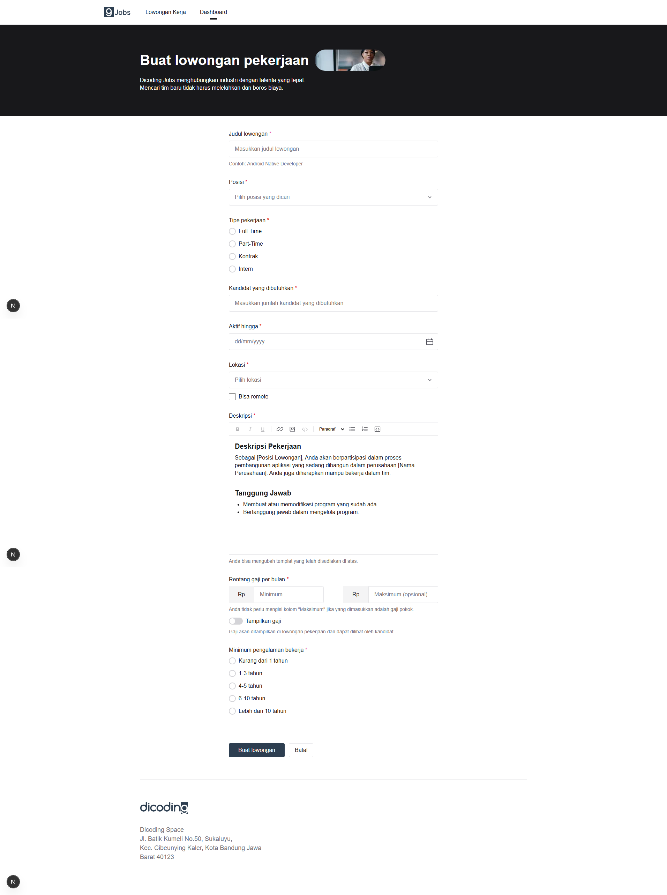

# Dicoding Jobs

A job vacancy application for the Dicoding Product Engineer Intern technical test, built with Laravel 13, Next.js 16, and SQLite. Job seekers can browse, search by title, and open vacancy details. Recruiters can create, edit, and delete vacancies from the dashboard.

## Requirements

- PHP 8.3 or later with Laravel's required extensions, including `pdo_sqlite` and `sqlite3`.
- Composer 2.
- Node.js 22 and npm.
- Git and Chrome, Edge, or Playwright Chromium for browser tests.

SQLite is allowed by the brief's requirement for any SQL database. It keeps setup self-contained without a database server or Docker. Migrations, factories, seeders, and integration tests use SQL persistence. Moving to MySQL would require checking its different SQL behavior.

## Installation

Clone the repository and install the backend:

```sh
git clone https://github.com/arulzkash/vacancy.git
cd vacancy/backend
composer install
composer run setup
php artisan db:seed
```

Setup creates `.env`, an application key, and `database/database.sqlite`, then runs migrations. Repeating setup preserves existing settings and data. Seeding adds four sample vacancies without duplicating or overwriting existing samples.

From the repository root, install the frontend:

```sh
cd frontend
npm ci
npm run setup
```

Frontend setup creates `.env.local` from `.env.example` and preserves an existing file. Both dependency lockfiles are included.

## Run locally

In one terminal, from `backend`:

```sh
composer run dev
```

In another terminal, from `frontend`:

```sh
npm run dev -- --hostname 127.0.0.1 --port 3000
```

Open [the application](http://127.0.0.1:3000). The API runs at `http://127.0.0.1:8000`; [GET /up](http://127.0.0.1:8000/up) checks its database connection. Stop servers with `Ctrl+C`.

| Environment file | Setting | Default |
| --- | --- | --- |
| `backend/.env` | `DB_CONNECTION` | `sqlite` |
| `backend/.env` | `APP_URL` | `http://127.0.0.1:8000` |
| `backend/.env` | `FRONTEND_URL` | `http://127.0.0.1:3000` |
| `frontend/.env.local` | `NEXT_PUBLIC_API_BASE_URL` | `http://127.0.0.1:8000` |

Use the same hostname consistently. When ports change, update these origins and restart the servers. The frontend API URL must omit `/api`. Public frontend environment values are included at build time.

For a production frontend build, stop its development server first, then run from `frontend`:

```sh
npm run build
npm run start -- --hostname 127.0.0.1 --port 3000
```

Keep the Laravel server running separately. These commands demonstrate a production frontend build locally; public hosting is outside this exercise.

## Try the main flows

1. Open `/vacancies`, search for `Developer`, then select a card. Detail displays the stored description, company metadata, experience, and candidate count. Returning to the list preserves the search.
2. Open **Dashboard**, select **Buat lowongan**, and fill in the form. After saving, the public list opens with a success message and no search keyword. Search for the new title and open its detail.
3. From **Dashboard**, select **Edit**. Saving returns to the dashboard with updated data; cancelling preserves the stored vacancy.
4. Select **Hapus**, review the title, and confirm. Cancelling or Escape preserves the vacancy; confirmation permanently deletes it.

Dates use Asia/Jakarta. Closing dates must be today or later. Position and location offer suggestions and accept custom text. The create form requires a minimum salary; the maximum is optional. Public list/detail show salary only when **Tampilkan gaji** is enabled; hidden amounts are returned as `null` by public API responses.

The rich-text editor supports headings, bold, italic, underline, lists, links, code, and images through absolute HTTP(S) URLs. HTMLPurifier sanitizes descriptions on the server. Descriptions must contain visible text; empty markup and images alone are rejected. Failed submissions keep entered values. Loading, empty, not-found, and retry states are included.

## Tests and checks

To run the verification sequence from the repository root:

```sh
node scripts/verify.mjs
```

This stops at the first failure and runs PHPUnit, Pint, Composer validation,
ESLint, TypeScript, two separate Playwright runs, and a production build.
Each browser run resets only the dedicated E2E database. The script also checks
that the development database's SHA-256 checksum is unchanged across the sequence.
Avoid editing development data while this check is running.

The completed visual audit in `responsive.spec.ts` is excluded from this sequence;
the feature tests still run. Use `npm run test:e2e` from `frontend` to include the
responsive audit. The production build uses `.next-e2e` so a running development
server can keep using `.next`. Install both projects' dependencies before running
the sequence, and leave ports 8001 and 3001 available.

Run backend tests and checks from `backend`:

```sh
composer test
composer run lint
composer validate --no-check-publish
```

Run frontend checks from `frontend`:

```sh
npm run lint
npm run typecheck
npm run build
```

### Browser tests

On Windows, Playwright automatically uses Chrome or Edge when installed. If neither browser is available, or on other platforms, install Chromium from `frontend`:

```sh
npx playwright install chromium --no-shell
```

On Linux, install missing browser system libraries with `npx playwright install --with-deps chromium --no-shell`.

Then run:

```sh
npm run test:e2e
```

The suite covers list → search → detail using the actual Laravel API, create/edit/delete, rich text, salary privacy, validation, loading/empty/not-found states, and failures with retry. Fixtures clean only the records they create.

Playwright starts its own backend on port **8001** and frontend on port **3001**. These ports must be available. The regular development servers can remain running on ports 8000 and 3000.

Use `npm run test:e2e:ui` for interactive tests or `npx playwright show-report` to open the HTML report.

To select an installed browser explicitly in PowerShell:

```powershell
$env:PLAYWRIGHT_CHANNEL = 'chrome' # or 'msedge'
npm run test:e2e
```

Run `Remove-Item Env:PLAYWRIGHT_CHANNEL` to restore automatic browser selection. If PHP is not available on PATH, set `PHP_BINARY` to the PHP executable path.

### Test databases

| Environment | Database |
| --- | --- |
| Local development | `backend/database/database.sqlite` |
| PHPUnit | SQLite `:memory:` |
| Playwright | `backend/database/e2e.sqlite` |

PHPUnit runs migrations in memory. Playwright resets and seeds its dedicated database before starting the test server and uses a separate frontend build directory, `.next-e2e`.

If Laravel configuration has been cached, clear it from `backend` before running browser tests:

```sh
php artisan config:clear
```

## Architecture and API

Laravel handles validation, SQL persistence, HTML sanitization, and API resources. Next.js renders the UI; TanStack Query handles server state and cache invalidation, React Hook Form handles form state, and Tiptap edits descriptions.

```text
backend/app/                      Controllers, requests, resources, model, sanitizer
backend/database/                 Migrations, factory, seeder
backend/tests/                    PHPUnit unit and integration tests
frontend/src/app/                 Routes and layouts
frontend/src/components/          Shared layout and icons
frontend/src/features/vacancies/  API calls, hooks, form values, utilities
  components/list/               Job cards, search, list states
  components/detail/             Metadata and description rendering
  components/dashboard/          Management cards and delete confirmation
  components/form/               Shared create/edit form and fields
  components/editor/             Rich-text editor and toolbar
frontend/tests/e2e/               Playwright tests and fixtures
scripts/verify.mjs                Verification sequence
```

| Method | Endpoint | Purpose |
| --- | --- | --- |
| GET | `/api/vacancies?search=Developer` | List and optional title search |
| GET | `/api/vacancies/{id}` | Public detail |
| POST | `/api/vacancies` | Create |
| GET | `/api/vacancies/{id}/edit` | Stored edit form values |
| PUT | `/api/vacancies/{id}` | Update |
| DELETE | `/api/vacancies/{id}` | Delete |

See [API documentation](docs/api.md) for payloads, validation, response contracts, and an example request.

## Scope and limitations

The required create/list/detail APIs, title search, reusable Job Card, API integration, and unit/integration/E2E tests are implemented. Dashboard, edit, and delete are additional features.

- This is a single-company exercise without authentication or ownership checks. The dashboard manages all vacancies, and the edit endpoint returns stored hidden salary values.
- Pagination, location/type filters, applications, bookmarks, file uploads, and collaborative editing are not implemented.
- Expired vacancies remain accessible. Search is case-insensitive for ASCII letters; SQLite does not provide full Unicode case folding by default.
- External description images depend on the image host's availability.
- The current dependency audit reports five high-severity findings in the ESLint development dependency chain. The production-only npm audit reports none. Automatic fixes propose incompatible dependency changes and have not been applied.

## Screenshots and assets









Design reference: Dicoding Figma. Branding, hero images, and the dashboard banner are stored locally in `frontend/public/images`. The local Inter font includes its [SIL Open Font License](frontend/public/fonts/OFL.txt).
